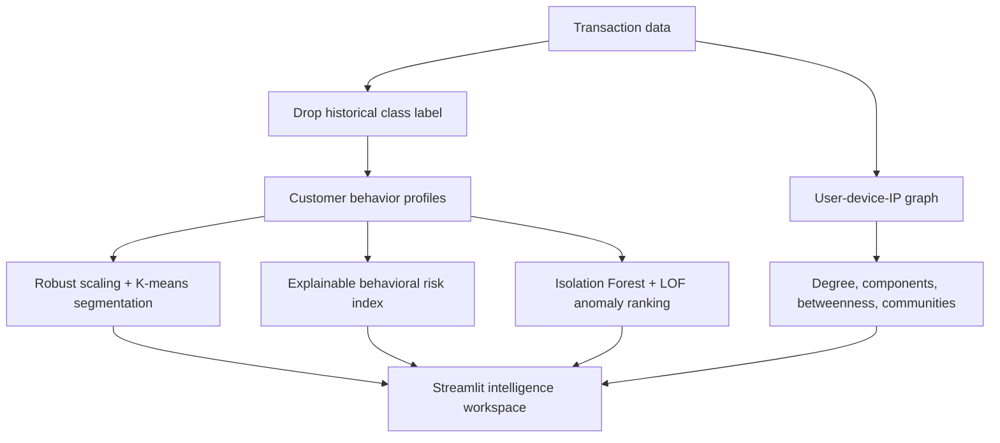

# ◈ Graph-Based Customer Intelligence

**Discover customers · Understand behavior · Identify risk · Find hidden anomalies**

[Live Streamlit app](https://graph-anomaly-supervised-neural-prediction-v1.streamlit.app/) · [GitHub repository](https://github.com/Harshithpatali/Graph-anomaly-supervised-neural-prediction) · [Research workflow](https://github.com/Harshithpatali/Graph-anomaly-supervised-neural-prediction/actions/workflows/customer-intelligence-research.yml)

An unsupervised customer intelligence research platform built around customer behavior, network relationships, segmentation and anomaly discovery. The primary product is **not a supervised fraud classifier**.

## Product experience

| Workspace | What it answers |
|---|---|
| **Overview** | Customer, transaction, graph and segment counts; cohort-level risk and anomaly distributions |
| **Customer Explorer** | Individual purchase behavior and reasons a profile was surfaced |
| **Customer Segments** | Behavioral groups discovered through unsupervised clustering |
| **Graph Intelligence** | Structural importance of devices, IP addresses and connected components |
| **Anomaly Lab** | Customers and transactions that are unusual under unsupervised scoring |
| **Methodology** | Data provenance, methods, interpretation and limitations |

## Research architecture



## Modeling guardrails

- The historical `class` label is dropped before customer feature generation.
- It is not used in segmentation, behavioral risk ranking, graph construction or unsupervised anomaly scoring.
- Behavioral risk is a **cohort-relative heuristic from 0–100**, not a calibrated probability.
- Customer anomaly ranking combines Isolation Forest percentile (60%) and Local Outlier Factor percentile (40%).
- Segment IDs are arbitrary cluster identifiers, not ordinal value tiers.
- Graph construction currently uses at most the first 50,000 input transactions.
- Entity frequency features are full-snapshot descriptive counts, not point-in-time predictive features.
- Outputs are exploratory decision-support signals. Do not use them alone to block, accuse or penalize customers.

## Dashboard data

The app reads precomputed files from `reports/customer_intelligence/`:

- `customer_intelligence.parquet`
- `customer_profiles.parquet`
- `top_transaction_anomalies.parquet`
- `segment_summary.csv`
- `segmentation_metrics.csv`
- `graph_entity_metrics.csv`
- `graph_communities.csv`
- `run_metadata.json`

The GitHub Actions workflow uploads these as an artifact named **customer-intelligence-research**. If the reports are not bundled with the Streamlit deployment, download the ZIP artifact from a successful Actions run and upload it in the dashboard sidebar. The dashboard does not train models or rebuild the graph during startup.

## Run research on GitHub

1. Open [Actions → Customer intelligence research](https://github.com/Harshithpatali/Graph-anomaly-supervised-neural-prediction/actions/workflows/customer-intelligence-research.yml).
2. Select **Run workflow** (or push a change to research source files).
3. Wait for tests and report generation to complete.
4. Download the `customer-intelligence-research` artifact ZIP.
5. Upload the ZIP in the Streamlit sidebar if the deployment does not contain the reports.

## Run locally

Requires Python 3.10+ and the source dataset at `data/raw/Fraud_Data.csv`.

```bash
git clone https://github.com/Harshithpatali/Graph-anomaly-supervised-neural-prediction.git
cd Graph-anomaly-supervised-neural-prediction
python -m venv .venv
pip install -r requirements.txt
python scripts/build_customer_intelligence.py
python -m streamlit run app/app.py
```

Windows PowerShell activation: `.venv\Scripts\Activate.ps1`  
macOS/Linux activation: `source .venv/bin/activate`

## Project structure

```text
app/app.py                         # Graph-Based Customer Intelligence UI
src/customer_intelligence.py       # User-level behavioral profiles
src/customer_risk.py               # Explainable relative risk index
src/customer_segmentation.py       # Unsupervised K-means segmentation
src/unsupervised_anomalies.py      # Isolation Forest + LOF
src/graph_intelligence.py          # User-device-IP network metrics
scripts/build_customer_intelligence.py
tests/test_customer_intelligence.py
reports/customer_intelligence/     # Generated reports (workflow artifact)
.github/workflows/customer-intelligence-research.yml
```

## Historical research

Earlier supervised fraud-classification and chronological validation experiments remain in the repository as historical research. They are not the primary dashboard experience and do not drive current customer segmentation, behavioral risk, graph or anomaly outputs.

## Author

**Harshith Devaraja** · [GitHub](https://github.com/Harshithpatali)
